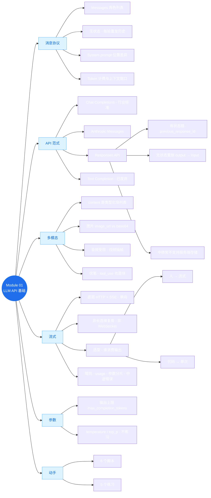

# Module 01: LLM API 基础

> 🎯 **学习目标**: 理解 LLM API 的核心概念，能够调用 Claude 和 OpenAI 的 API 完成基本对话

## 🧠 全景思维导图

本模块的知识结构（五个分支：消息协议、API 范式、多模态、流式、参数）：



> 🖼️ 环境不渲染 mermaid 时（部分 GHE 配置禁用），看 [PNG 版思维导图](../docs/images/module01-mindmap.png)

## 📖 理论知识

### 1. 消息协议 — 一切的地基

#### 1.1 什么是 Messages API？

LLM（大语言模型）通过 **Messages API** 提供服务。你发送一组消息（对话历史），模型返回一个回复。

```
你（Client）→ [消息列表] → LLM API → [回复] → 你
```

核心概念：
- **Messages**: 一个消息列表，交替包含 `user` 和 `assistant` 角色的消息
- **System Prompt**: 给模型的"人设"指令，不在 messages 里，单独传入
- **Model**: 指定使用哪个模型（如 `claude-sonnet-4-20250514`、`gpt-4o`）
- **Max Tokens**: 限制回复的最大 token 数

**多轮对话的本质**：API 是无状态的——所谓"记忆"是客户端每次把完整对话历史重新发一遍，模型本身不保存任何状态。这个认知对 Agent 开发至关重要（工具调用结果也是以同样方式追加进 messages 的）。

#### 1.2 Claude vs OpenAI 核心差异

| 特性 | Claude (Anthropic) | OpenAI (GPT) |
|------|-------------------|--------------|
| 端点 | `messages.create()` | `chat.completions.create()` |
| 输出上限 | `max_tokens` | `max_completion_tokens`（GPT-5/o 系列必需，传 `max_tokens` 会 400；旧模型如 gpt-4o 两者皆可） |
| System Prompt | 独立的 `system` 参数 | `messages` 中 `role="system"` |
| 停止原因 | `stop_reason` | `finish_reason` |
| 回复结构 | `response.content[0].text` | `response.choices[0].message.content` |
| 流式输出 | `messages.stream()` context manager | `stream=True` 参数 |
| 图片输入 | `{"type": "image", "source": {...}}` 块（仅 base64） | `{"type": "image_url", ...}` 块（URL 或 base64） |
| Token 字段 | `input_tokens` / `output_tokens` | `prompt_tokens` / `completion_tokens` |

### 2. API 范式 — Chat Completions vs Responses

OpenAI 目前维护两套范式不同的 API。Chat Completions 是老牌范式、也是**行业互操作标准**（DeepSeek、GLM、vLLM、Ollama 等全都兼容它）；Responses 是 OpenAI 2025 年起主推的第二代范式，新特性优先落在它上面。

| | Chat Completions | Responses API |
|---|---|---|
| 请求结构 | `messages`（角色消息列表） | `input`（字符串或 item 列表） |
| 响应结构 | `choices[0].message` | `output` item 列表（message / reasoning / function_call…） |
| 状态 | 无状态，每轮重发全部历史 | `previous_response_id` 可把状态存服务端 |
| 工具 | function calling（**你的代码**执行） | 另有平台托管工具（web_search / code_interpreter…） |
| 推理模型 | 每轮丢弃思考过程 | reasoning item 可跨轮复用 |
| 生态 | 跨厂商通用 | OpenAI 独有 |

交互层面的取舍：

- **有状态链**（`previous_response_id`）：请求轻、客户端代码简单，但历史存在服务端（默认 `store=True`，有保留期）——你想删一段、截断、分支重试都做不到，且 `store=False` 时此路不通
- **无状态重放**：把上一轮 `output` items 塞回 `input` —— 历史控制权 100% 在自己手里，可以随意截断/修改/分支，**Agent 框架普遍用这种姿势**
- 注意：两种方式 token 都照常计费（服务端拼历史不等于免历史）

> ⚠️ **中转/网关兼容性**: `previous_response_id` 依赖服务端保存 Responses。多上游账号负载均衡或禁用 `store` 的网关会返回 `previous_response_not_found`。示例脚本 `responses_api.py` 已做优雅降级——失败时打印原因并继续，无状态重放（Demo 3）不受影响。

> Anthropic 没有对应的第二代 API，Messages API 仍是其唯一范式。

### 3. 多模态 — content 是块列表

消息的 `content` 不只是字符串——它可以是**类型化块（parts/blocks）列表**，文本、图片、音频平级共存：

| 块类型 | OpenAI（Chat / Responses） | Claude |
|---|---|---|
| 文本 | `{"type": "text"}` | `{"type": "text"}` |
| 图片 | `{"type": "image_url"}`（URL 或 `data:` base64 URI；Responses 为 `input_image`） | `{"type": "image", "source": {"type": "base64", ...}}`，**不收 URL** |
| 音频 | `{"type": "input_audio"}`（仅 audio 类模型） | ❌ 不支持 |
| 视频 | ❌ 不能直接输入 | ❌ 不能直接输入 |

- 图片按尺寸折算 token（大致 `(宽×高)/750`），在 usage 里直观可见
- 视频理解的标准做法是抽帧成多张图片；原生视频输入是 Gemini（parts-based schema）的独门能力
- 🔗 **重要伏笔**: Module 02 的 `tool_use` / `tool_result` 也是 content block——多模态和工具调用共享同一套分块协议

> 🧪 **实测观察**: 同一张 128×128 白底红方块图，Claude 正确识别出红色方块，某 GPT-5 版本却只看到"浅灰色背景"。图片数据是同一份（base64 常量）——**不同模型的视觉能力差异可以很大，换模型要重测视觉任务**。

### 4. 流式输出

#### 4.1 底层：HTTP + SSE

`streaming.py` 的"打字机效果"**不是独立的传输协议**，而是 HTTP 之上的 **SSE（Server-Sent Events）**用法：

- 请求就是普通 HTTP POST（带 `"stream": true`）；区别在响应——`Content-Type: text/event-stream`、没有 Content-Length（chunked 分块传输）、连接保持打开
- SSE 占用的是**一个长时间不结束的 HTTP 响应**（不是 Keep-Alive 那种连接复用）
- 服务端每生成一段就推一个事件，如 `data: {"choices":[{"delta":{"content":"你"}}]}\n\n`；OpenAI 以 `data: [DONE]` 结束，Claude 用 `event: content_block_delta` 等带类型的事件
- SSE 是**单向**的（服务器→客户端）；需要双向实时（如语音对话）才用 WebSocket（OpenAI Realtime API）
- 肉眼验证原始事件流：`curl -N https://api.openai.com/v1/chat/completions -H "Authorization: Bearer $KEY" -H "Content-Type: application/json" -d '{"model":"gpt-4o","stream":true,"messages":[{"role":"user","content":"hi"}]}'`

#### 4.2 流式 vs 单次请求：怎么选

**判断标准只有一条：谁在消费这段输出——人眼，还是代码。**

**选流式的场景：**

1. **人在等**（聊天 UI、终端工具）。流式优化的是**感知延迟**：首 token 几百毫秒就到，而不是等 10-30 秒看到全文。总时长其实没变
2. **长输出 + 中间有网关/代理**。单次响应超过网关空闲超时（常见 30-60s）会被掐断；流式持续有字节流动，不会被 watchdog 杀掉
3. **要可取消**。用户点停止 → abort 连接，立刻停止计费

**选单次的场景：**

1. **代码消费输出**。Agent 循环里下一步动作需要**完整**回复才能判断（tool call 的参数 JSON 缺一半没法解析）——流式拼半天的产物和单次一样，只剩复杂度
2. **批量、评估、结构化提取**等后台任务
3. **错误处理干净**。单次调用错误 = HTTP 状态码；流式的响应头已经是 200，**错误可能在流的中途以事件形式到达**（经过中转网关时尤其要防）

**流式的三个暗坑：**

| 坑 | 说明 |
|---|---|
| usage 要额外请求 | OpenAI 需传 `stream_options: {"include_usage": true}`；Claude 在结尾 `message_delta` 事件里给 |
| tool call 参数分片 | 流式下 `tool_calls` 的 `arguments` 字符串拆成多个 delta 到达，要自己拼接（Agent 流式化最烦的部分） |
| 事件 schema 不同 | OpenAI `delta` vs Claude `content_block_delta`，各家解析器不通用 |

**经验法则：面向人的界面用流式，面向代码的循环用单次。** 真实产品里的 Agent 也常用混合模式——工具调用阶段非流式、最终回答流式。Module 03/04 写工具循环时我们先用非流式（`tool_use` block 完整到达，处理极简），理解循环后再把流式作为进阶练习。

### 5. Token 与采样参数

#### 5.1 Token 是什么？

Token 是模型处理文本的基本单位。大约：
- 1 个英文单词 ≈ 1-2 tokens
- 1 个中文字 ≈ 1-2 tokens
- 代码中的符号 ≈ 1 token

**为什么 Token 重要？**
- API 按 token 计费（输入 + 输出分别计费）
- 模型有上下文窗口限制（如 Claude: 200K tokens, GPT-4o: 128K tokens）
- `max_tokens` 控制输出长度

#### 5.2 输出上限参数"一家亲"

| 范式 | 参数 | 备注 |
|---|---|---|
| Claude Messages | `max_tokens` | 必填 |
| OpenAI Chat Completions | `max_completion_tokens` | GPT-5/o 系列必需；旧模型也接受 `max_tokens` |
| OpenAI Responses | `max_output_tokens` | 推理模型要把一部分预算留给 reasoning |

#### 5.3 Temperature / Top-P — 🚫 本项目不练习

**是什么（理解概念即可）：**
- **Temperature** (0.0 ~ 1.0): 越高越随机/创意，越低越确定/稳定。0.0 适合分类提取，1.0 适合创意写作
- **Top-P**: 限制采样范围到累积概率前 P% 的 token
- 两家都建议只用其中一个，不要同时设置

**为什么不练习：**

1. **正在被淘汰**：o 系列传 `temperature` 直接 400；GPT-5 基本只认默认值 1；Claude Opus 4.7+ 已移除该参数改用 `effort`——新一代推理模型统一转向"推理力度"控制（`reasoning_effort` / `effort`），学采样参数的投入产出比很低
2. **Agent 开发几乎用不到**：生产 Agent 的确定性靠 prompt 工程 + 结构化输出 + 工具协议保证，不靠调温度
3. 本模块所有脚本一律使用模型默认值；想要确定性行为时，用下一模块的结构化输出（JSON Schema）来实现

## 💻 示例代码

按以下顺序运行：

1. `src/hello_claude.py` — 你的第一次 Claude API 调用
2. `src/hello_openai.py` — 你的第一次 OpenAI API 调用
3. `src/multi_turn.py` — 多轮对话（两个 Provider 对比）
4. `src/streaming.py` — 流式输出（实时打印，底层 HTTP + SSE）
5. `src/responses_api.py` — OpenAI Responses API（有状态链 + 无状态重放）
6. `src/multimodal.py` — 多模态输入（图片，两个 Provider 对比）

运行方式：
```bash
uv run python 01_llm_basics/src/hello_claude.py
```

## ✏️ 练习

见 `exercises/README.md`

## 🎉 模块小结（2026-10-17 收尾）

**带走的五个核心能力**（对应思维导图五个分支）：

1. **消息协议** — API 无状态，"记忆"是客户端重发完整历史；两家 system prompt 位置 / 响应结构 / token 字段的差异
2. **API 范式** — Chat Completions（行业互操作标准）vs Responses（有状态链 / 无状态重放）；历史控制权决定 Agent 架构选型
3. **多模态** — content 是类型化块列表，text / image 平级共存；`tool_use` 块是同一协议的延伸（Module 02 的地基）
4. **流式** — 底层是 HTTP + SSE（单向、非 WebSocket）；选型判据"谁消费输出"：人 → 流式，代码 → 单次
5. **参数** — 输出上限三兄弟（`max_tokens` / `max_completion_tokens` / `max_output_tokens`）；采样参数正被推理模型世代淘汰，本项目不练习

**本模块实测记录：**

- 中转网关不支持服务端保存 Responses（`previous_response_not_found`），无状态重放在同一端点不受影响——有状态链绑定基础设施的活例子
- 同一张 128×128 白底红方块图，GPT-5.6 两次运行均未识别红方块、Claude 两次均正确——**视觉能力是模型级差异，换模型必须重测**
- 128×128 图片折算 token：OpenAI 35 / Claude 50

**下一步** → Module 02（Tool 定义）：手写 JSON Schema → Pydantic 自动生成 → 装饰器注册中心。
带着 01 的伏笔去看：模型的工具调用请求（`tool_use`）和你的执行结果回传（`tool_result`），正是 content block 列表里的两种新块。
