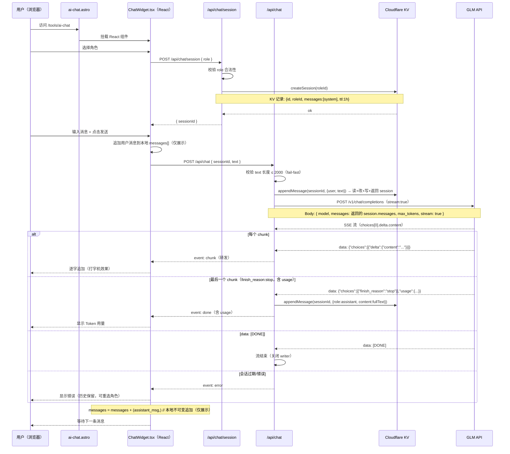

# Web AI NPC 聊天实现

> 集成到现有 Astro 5 + Cloudflare Workers 网站 [my.woshicai.tech](https://my.woshicai.tech)
> 状态：**Phase 1-3 已全部实施并上线**（2026-06）

| Phase | 内容 | 状态 |
|-------|------|------|
| [Phase 1：流式聊天 MVP](./phase-1) | GLM API 流式对话、5 个内置角色、服务端会话、部署踩坑 | ✅ 已上线 |
| [Phase 2：角色 CRUD](./phase-2) | 角色迁移到 Cloudflare KV、管理端点、Token 估算、备选角色池 | ✅ 已上线 |
| [Phase 3：会话持久化](./phase-3) | 会话列表、Title 自动生成、LRU 淘汰、ChatWidget 拆分 | ✅ 已上线 |

---

## 概述

在现有 Astro 5 + Cloudflare Workers 网站上添加 AI NPC 聊天页面。用户选择幻想世界 NPC 角色，输入文字，以打字机效果接收 GLM API（OpenAI 兼容协议）的流式回复，每次回复后显示 Token 用量。

**核心设计决策：**

- **LLM 后端用 GLM API（OpenAI 兼容协议）** — `POST /v1/chat/completions`，system prompt 作为 `role: "system"` 消息内嵌在 messages 数组中
- **会话历史由服务端持有（Cloudflare KV）** — 客户端只持有 sessionId，每轮只发送当前用户输入，杜绝伪造历史和注入上下文
- **服务端自动截断上下文** — 保留 system prompt + 最近 20 轮对话（40 条消息），防止超出 context window
- **不引入任何 LLM SDK** — 直接用 `fetch`，零依赖，Cloudflare Workers 兼容
- **React 19 做聊天 UI** — 聊天需要复杂的状态管理（流式文本、不可变消息数组），React 已是项目依赖
- **TypeScript 严格模式** — 全量类型覆盖
- **纯不可变状态管理** — 不引入外部状态库
- **API key 仅限服务端** — 所有 API 调用通过 `/api/chat` 代理，绝不暴露给客户端
- **遵循现有项目规范** — Tailwind CSS、astro-orange 主题色、深色模式、container 布局

---

## 架构与数据流



**信任边界：** 消息历史的唯一真相来源是服务端 KV。客户端的 `messages[]` 降级为纯展示数组，不参与请求构造，无法伪造 `role: "assistant"` 历史或注入额外上下文。system prompt 完全在服务端组装，客户端无权修改。

**客户端与 /api/chat 之间的 SSE 流协议：**

`/api/chat` 端点返回 `Content-Type: text/event-stream` 的 `ReadableStream`。流中发送自定义事件：

```
event: chunk
data: {"type":"chunk","text":"你好"}

event: chunk
data: {"type":"chunk","text":"旅人"}

event: done
data: {"type":"done","usage":{"input_tokens":50,"output_tokens":12,"total_tokens":62}}

event: error
data: {"type":"error","message":"会话已过期，请重新选择角色"}
```

客户端请求体（`POST /api/chat`）：

```json
{ "sessionId": "uuid-xxxx", "text": "你好，铁匠" }
```

客户端不再发送 `messages[]` 数组，只发送 `sessionId` + 当前用户输入。

---

## 项目结构

在现有项目中新增以下文件：

```
src/
├── pages/
│   ├── api/
│   │   └── chat/
│   │       ├── index.ts            # [新增] POST /api/chat — 流式聊天（读 KV 历史 + 调 GLM）
│   │       └── session.ts          # [新增] POST /api/chat/session — 建会话（返回 sessionId）
│   └── tools/
│       ├── ai-chat.astro           # [新增] 聊天页面（React 挂载点）
│       └── index.astro             # [修改] 工具列表添加 AI Chat 入口
├── components/
│   └── chat/
│       ├── ChatWidget.tsx          # [新增] 主聊天编排组件
│       ├── RoleSelector.tsx        # [新增] 角色选择器（卡片列表）
│       ├── MessageList.tsx         # [新增] 流式消息展示
│       └── ChatInput.tsx           # [新增] 文本输入 + 发送按钮
└── lib/
    ├── chat.ts                     # [新增] 类型定义、SSE 辅助、常量
    ├── roles.ts                    # [新增] NPC 角色定义（5 个默认角色）
    ├── session.ts                  # [新增] 会话 KV CRUD + 截断 + TTL
    └── env.ts                      # [修改] 新增 getGlmApiKey()、getGlmModel()、getChatKv()
```

> **路由说明：** Astro 按文件路径映射 URL。`src/pages/api/chat/index.ts` → `/api/chat`，`src/pages/api/chat/session.ts` → `/api/chat/session`。

---

## 后续阶段规划（原始设计）

### Phase 2：角色 CRUD（Cloudflare KV）

Phase 1 中 5 个角色以 `as const` 硬编码在 `roles.ts`。Phase 2 将角色定义迁移到 Cloudflare KV，支持管理员增删改查：

- 角色 definitions 从 `NPC_ROLES` 常量迁移到 KV `ROLES_KV` 命名空间
- 新增 `GET/POST/PUT/DELETE /api/roles` 管理端点
- `createSession(roleId)` 从 KV 读取 role 而非常量 — `session.roleId` 字段不变，**零改动**
- 管理后台页面（需鉴权）

**对 Phase 1 的影响：** 无。`isValidRoleId` / `getRoleById` 内部改为读 KV，外部接口不变。

### Phase 3：会话持久化

Phase 1 中会话**已经存储在 KV**（1 小时 TTL）。Phase 3 在此基础上增强：

- **延长/取消 TTL：** 登录用户的会话设为 7 天或永久，匿名用户保持 1 小时
- **用户登录态：** 会话归属到 `userId`，跨设备同步
- **会话列表：** 用户可查看历史会话并继续对话
- **数据模型不变：** `ChatSession` 接口、`/api/chat` 契约、客户端逻辑都不需要结构性改动 — 只是渐进增强
- **可选升级：** 如需强一致性（多设备同时编辑同一会话），可从 KV 升级到 Durable Objects

**对 Phase 1 的影响：** 无。Phase 3 是在 Phase 1 基础设施之上的增量扩展。因为会话归属权从第一天起就在服务端，Phase 3 不需要任何架构迁移。

---

## 实施时间线（原始估算）

| 阶段 | 内容 | 预估工作量 |
|------|------|-----------|
| Phase 1 — 基础模块 | `roles.ts` + `chat.ts` + `session.ts` + `env.ts` | 0.5 天 |
| Phase 1 — API 端点 | `chat/index.ts` + `chat/session.ts` + wrangler KV 配置 | 0.5 天 |
| Phase 1 — 前端组件 | `ChatWidget` + `RoleSelector` + `MessageList` + `ChatInput` | 1 天 |
| Phase 1 — 页面集成 | `ai-chat.astro` + `index.astro` 更新 + 样式联调 | 0.5 天 |
| Phase 1 — 测试 | roles/chat/session 单测 + 手动验收（本地 + 部署） | 0.5 天 |
| **Phase 1 合计** | | **~3 天** |
| Phase 2 — 角色 CRUD | KV 角色存储 + 管理端点 + 后台页面 | 后续 |
| Phase 3 — 会话持久化 | 用户登录态 + 会话列表 + TTL 策略 | 后续 |


> 实际落地与原计划的偏差见各 Phase 页面（本节仅保留原始设计供对照）。
